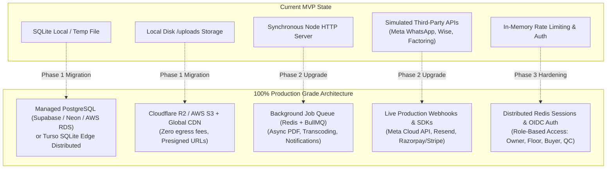
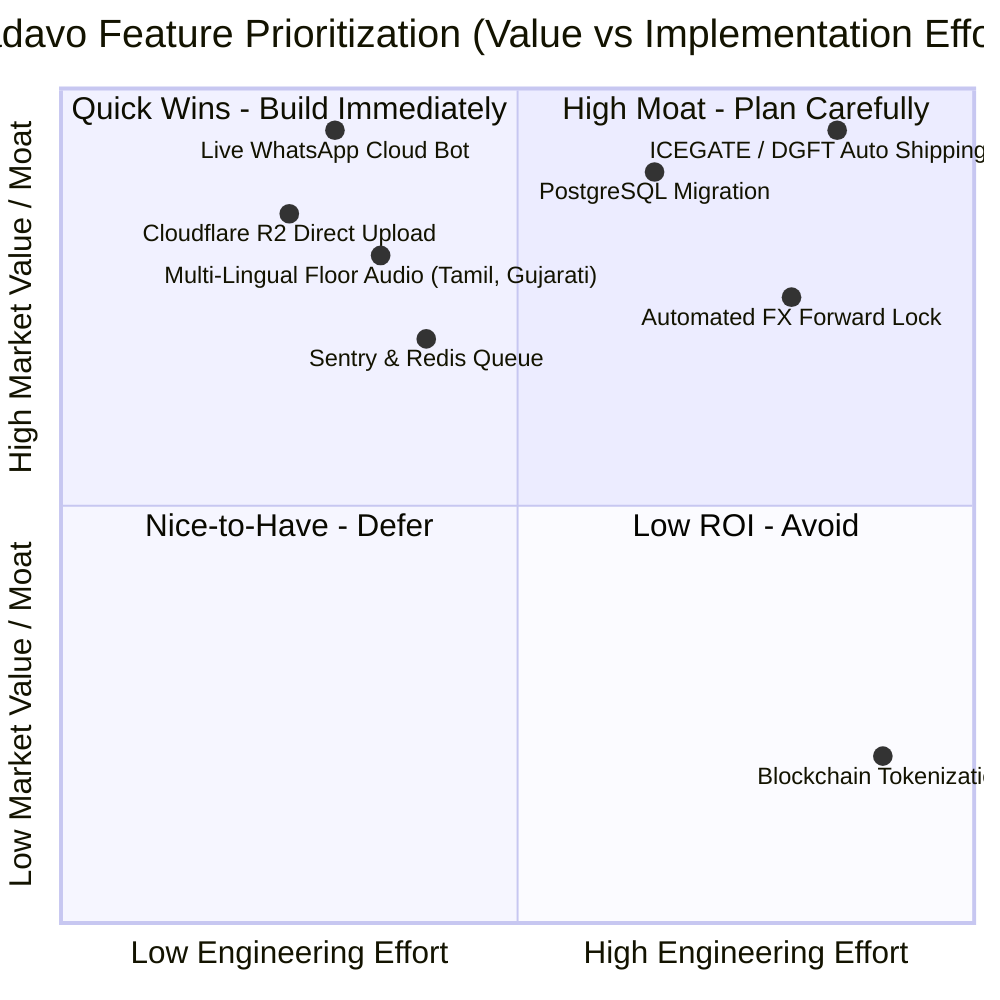

# PADAVO (पड़ाव) — MARKET & TECHNICAL READINESS AUDIT
**Perspective:** Market Analyst & Senior Full Stack Software Architect  
**Objective:** Gap Analysis, Scalability Roadmap & Enterprise SaaS Monetization Strategy  
**Current Version:** 2.0.0 (MVP+ / Pilot Stage)  
**Target:** 100% Production-Grade Commercial B2B SaaS  

---

## 1. Executive Summary & Honest Verdict

Padavo has an **exceptional product-market narrative and a rock-solid architectural core**:
- The positioning — **"Stop Chasing Foreign Buyers for Payments; Turn Shop-Floor Milestones into Wire Transfers"** — targets the exact #1 pain point of Indian SME exporters (delayed working capital, arbitrary buyer discounts, and lack of verified proof).
- The **RBI Zero-Custody architecture** is brilliant: it bypasses the ₹15+ Crore capital requirement of RBI Payment Aggregator Cross-Border (PA-CB) licensing, allowing instantaneous go-to-market.

However, moving from a **working prototype/pilot engine** to a **venture-scale or high-revenue commercial SaaS** requires addressing specific technical limitations and market-expansion gaps.

---

## 2. Technical Gaps & Deficiencies (Senior Full-Stack View)

### 2.1 Database & Concurrency Limitations
- **Current State:** Embedded SQLite (`node:sqlite`) in WAL mode.
- **The Gap:** SQLite is blazing fast for single-node VPS, but in serverless edge environments (Vercel, AWS Lambda), filesystems are ephemeral. If multiple serverless instances spin up, each instance writes to its own temporary database, causing **split-brain data corruption**.
- **Fix:**
  - *Option A (Serverless):* Migrate to **Turso / libSQL** (SQLite at the edge with global replication).
  - *Option B (Enterprise Scalability):* Migrate to **Managed PostgreSQL** (Supabase, Neon, or AWS RDS Postgres) using connection pooling (PgBouncer).

### 2.2 File & Media Storage
- **Current State:** Photos are stored in the local `/uploads/` directory.
- **The Gap:** On Docker container restarts or Vercel deployments, `/uploads` is wiped out. Production images must never live on the app server.
- **Fix:** Hook up **Cloudflare R2** or **AWS S3** with client-side direct presigned uploads. R2 has zero egress fees, making high-resolution factory photo uploads extremely economical.

### 2.3 Live Third-Party Integrations vs. Simulators
- **WhatsApp Cloud API:** Current webhook parser works, but needs live **Meta Developer App credentials** (Phone Number ID, Permanent System User Token, Webhook Verification Token).
- **Transactional Email:** Needs live API key from **Resend** or **Amazon SES** so foreign buyers receive real milestone notification emails with verified DKIM/SPF domain reputation.
- **Payment Gateway:** The recurring subscription engine needs live **Stripe Billing** or **Razorpay Subscriptions** webhook endpoints to automatically upgrade/downgrade exporter quotas.

### 2.4 Asynchronous Worker Queues (BullMQ / Redis)
- **Current State:** PDF generation and image processing happen in-process on the main Node.js event loop.
- **The Gap:** If 50 factory staff upload 5MB photos simultaneously, the event loop will block, increasing latency for foreign buyers.
- **Fix:** Offload image compression, PDF generation, and email dispatch to a background worker queue powered by **Redis + BullMQ**.

### 2.5 Observability, Logging & Error Tracking
- **Current State:** `console.log` and custom `audit_logs` SQLite table.
- **The Gap:** Zero automated alerts when an API crashes or when a foreign buyer encounters an error.
- **Fix:** Add **Sentry** for frontend & backend exception monitoring, and **Logtail / Datadog** for structured log aggregation.

---

## 3. Product & Market Deficiencies (Market Analyst View)

### 3.1 The Buyer Side Experience (The Real Payer)
- **Market Reality:** An Indian exporter cannot force an overseas buyer to use a complicated new tool. If the buyer feels friction, they will ignore the email.
- **Current State:** Padavo does this right by making the buyer link zero-login (`padavo.app/track/slug`).
- **Missing Hook:** Buyers don't just want wire instructions; foreign buyers often ask for **Net-30 / Net-60 credit terms**. If Padavo integrates an export invoice factoring partner (like Drip Capital, Modifi, or Stenn), foreign buyers get 60 days to pay while Indian exporters get paid 80% on day 1.

### 3.2 Indian Export Hub Linguistic Diversity
- **Market Reality:**
  - Jaipur / Moradabad / Panipat: Hindi / Urdu dialects.
  - Surat / Ahmedabad: Gujarati.
  - Tiruppur / Karur / Coimbatore: Tamil.
  - Kolkata / Cuttack: Bengali / Odia.
- **Missing Hook:** The factory floor audio note transcriber currently targets Hindi. Adding **Tamil and Gujarati language support** unlocks South India's ₹50,000 Crore textile belt (Tiruppur) and Surat's man-made fabric clusters.

### 3.3 Deep Customs Integration (ICEGATE / DGFT)
- **The Ultimate Competitive Moat:** Currently, stage 6 (Customs LEO & Bill of Lading) relies on the exporter uploading a PDF.
- **Future Moat:** Integrate with **ICEGATE (Indian Customs)** via shipping bill number / GSTN API. When customs grants LEO (Let Export Order), Padavo auto-verifies the final milestone and notifies the foreign buyer and bank without human intervention.

---

## 4. Prioritized Feature Roadmap (What to Add Next)

### 🚀 Phase 1: Production Hardening (Next 2 Weeks)
1. **Cloudflare R2 Bucket Integration:** Move all `/uploads/` photos to R2 presigned URLs.
2. **PostgreSQL / Turso Database Layer:** Replace single-file SQLite with a managed cloud database for infinite scale.
3. **Live Transactional Email (Resend SDK):** Deliver real HTML milestone notifications to buyer inboxes with 99.9% inbox deliverability.
4. **Sentry Error Tracking:** Plug Sentry into `server.js` and frontend HTML to catch any runtime exceptions before users notice.

### 📦 Phase 2: Factory & Buyer Experience (Month 1)
1. **Official Meta WhatsApp Cloud API Bot:** Enable factory supervisors to text a WhatsApp business number: `"PO 8492 Stage 2 Done"` with a photo, and have Padavo auto-link it.
2. **Multi-Lingual Voice Support (Tamil, Gujarati, Hindi):** Auto-detect dialect in browser speech-to-text.
3. **Role-Based Access Control (RBAC):**
   - *Floor Staff:* Upload photos only.
   - *QC Lead:* Fill and sign AQL 2.5 checklists.
   - *Accountant:* View Tally XML and bank receipts.
   - *Managing Director:* Approve draft stages and invite buyers.

### 💎 Phase 3: Fintech & Commercial Moat (Month 2–3)
1. **Real-time FX Rate Lock Widget:** Display live GBP/INR, USD/INR, EUR/INR interbank rates with 1-click forward cover quotes.
2. **ICEGATE Shipping Bill Verification:** Instant validation of customs shipping bill numbers to prevent fraudulent export claims.
3. **Buyer Referral Viral Engine:** When a UK buyer approves a milestone, prompt them: *"Do you source from other Indian suppliers? Invite them to Padavo for 1-click milestone tracking."*

---

## 5. Commercial SaaS Monetization Matrix

| Subscription Tier | Monthly Pricing | Target Customer | Quota & Features |
| :--- | :--- | :--- | :--- |
| **Starter Pilot** | Free Forever | First-time exporters | Up to 3 active consignments, zero-login buyer links, basic watermark. |
| **Pro Exporter** | ₹1,999 / month | Mid-sized artisan units (5–15 orders/mo) | Up to 20 active consignments, WhatsApp floor sync, e-FIRC generator, Tally Prime XML export. |
| **Export House Growth** | ₹4,999 / month | Established export houses (15–50 orders/mo) | Unlimited consignments, white-label custom domain (`track.yourbrand.com`), multi-cluster workflows, AQL 2.5 QC engine. |
| **Custom Enterprise** | ₹14,999 / month + API fee | Large manufacturing consortiums | Multi-factory tenant isolation, ERP/SAP bi-directional sync, custom SLA, dedicated account manager. |
